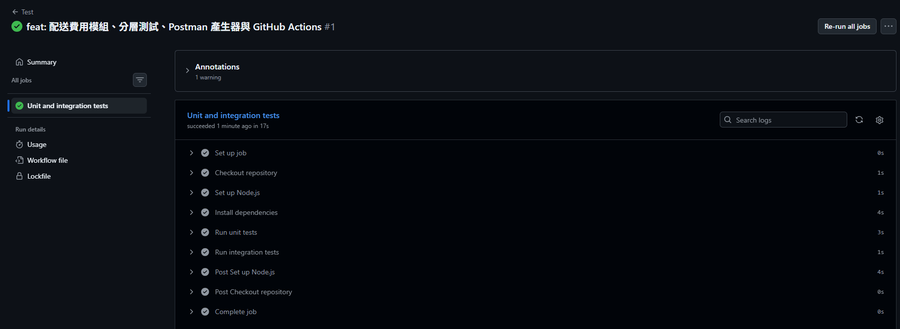
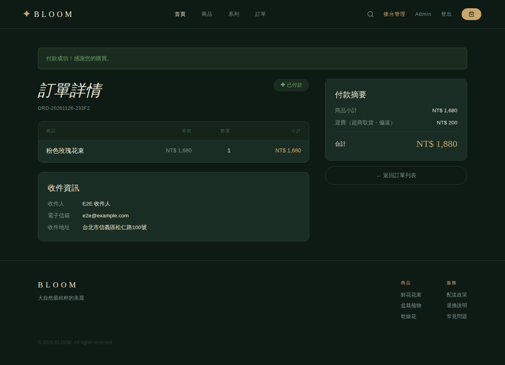

# 花卉電商（Flower E-Commerce）— AI 開發進化營 第三場作業

Node.js / Express REST API + EJS 前端，SQLite + JWT。本次作業在既有專案上加入**配送費用模組**，並建立 **Unit / Integration / E2E 分層測試、Postman Collection 與 GitHub Actions**。

## 繳交資訊

| 項目 | 內容 |
|------|------|
| GitHub 儲存庫 | https://github.com/rockayumitw/20260605_ai-adv-homework-course02 |
| 使用的 AI Agent | Claude Code（模型：Sonnet 5.5） |
| 挑戰等級 | **LV3**（各項完成狀態見下表） |
| 作業系統 | Linux（GitHub Codespaces，Ubuntu） |
| 新增或調整的環境變數 | `DATABASE_PATH`（選填，指定 SQLite 檔案或 `:memory:`，測試用）。其餘沿用 `.env.example`（`JWT_SECRET`、`ECPAY_*` 等），不含任何機密值 |
| GitHub Actions 執行頁面 | https://github.com/rockayumitw/20260605_ai-adv-homework-course02/actions/runs/45784703704 （`main`，commit `60b5486`，結果：success） |
| GitHub Actions 成功截圖 | [`_docs/github-actions-success.png`](_docs/github-actions-success.png)（見下方） |

### 完成狀態

| 項目 | 狀態 |
|------|------|
| LV1：Shipping 模組、訂單整合、前端介面、Unit Test、docs 與 `openapi.json` | 完成，`npm run test:unit` 通過 |
| LV2：Integration Test（記憶體 SQLite） | 完成，`npm run test:integration` 通過 |
| LV2：Postman Collection | 完成，`npm run postman` 可產生有效 JSON |
| LV2：E2E Test | 完成。`tests/e2e/checkout-ecpay.spec.js` 已實跑通過（登入 → 結帳含配送 → 綠界網路 ATM／土地銀行 → 返回商店 → 訂單 `paid`），付款成功並返回站點後的截圖：[`_docs/payment-success-returned.png`](_docs/payment-success-returned.png)（見下方） |
| LV3：GitHub Actions（`.github/workflows/test.yml`） | 完成，Unit 與 Integration 兩個步驟皆通過（見上方連結） |

### 截圖

**GitHub Actions 成功畫面**（Unit 與 Integration 測試皆通過）



**E2E：綠界付款成功並返回站點後，訂單顯示「已付款」**



> 說明：Unit Test 與 Integration Test 放在專案既有的 `tests/` 資料夾（作業文字寫 `./test/`），指令與結果不受影響。

## 配送費用規則

| 條件 | 費用 |
|------|------|
| 宅配基本運費 | 120 元 |
| 超商取貨 | 60 元 |
| 商品小計滿 1,500 元 | 免基本運費 |
| 偏遠地區 | 加收 200 元 |
| 當日急件 | 加收 250 元 |

附加費兩種配送方式皆適用，可同時成立；滿額免運只免基本運費，附加費照收。邏輯集中在 `src/utils/shipping.js`，訂單 `total_amount = subtotal + shipping_fee`。

## 快速開始

```bash
npm install
cp .env.example .env        # 填入 JWT_SECRET
npm run dev:server          # http://localhost:3001
```

預設管理員：`admin@hexschool.com` / `12345678`

## 指令

| 指令 | 說明 |
|------|------|
| `npm run test:unit` | Shipping 單元測試 + 原有 API 測試（暫存 SQLite，不動 `database.sqlite`） |
| `npm run test:integration` | 訂單建立流程 Integration Test（記憶體 SQLite） |
| `npm run test:e2e` | Playwright E2E，使用**已啟動**的 `http://localhost:3001` |
| `npm run postman` | 產生最新 `openapi.json` 與 Postman Collection（輸出到 `postman/`，不 commit） |
| `npm test` | unit + integration |
| `npm run openapi` | 只產生 `openapi.json` |

測試用的環境變數由 `vitest.config.js` 注入，跑 unit / integration **不需要 `.env`**。

### E2E 前置條件

1. 先建好 CSS 並啟動專案：`npm run css:build`（`public/css/output.css` 是建置產物、不在 repo 裡），再 `npm run dev:server`（需 `.env` 的 `JWT_SECRET` 與 `ECPAY_*`）；或直接 `npm start`。頁面的 Vue 從 `unpkg.com` 載入，瀏覽器需能連外網。
2. 安裝瀏覽器：`npx playwright install chromium`；Linux 另需 `sudo npx playwright install-deps chromium`。
3. 需能連到綠界測試環境 `payment-stage.ecpay.com.tw`。
4. 想看畫面：`HEADED=1 npm run test:e2e`。

### Postman

`npm run postman` 會輸出 `postman/flower-ecommerce.postman_collection.json`：使用 `{{baseUrl}}`（預設 `http://localhost:3001`），含 `baseUrl`、`token`、`sessionId` 變數；登入 / 註冊成功後自動把 JWT 存進 `token`，需要登入的 API 自動帶 Bearer Token。

## 文件

- [docs/README.md](docs/README.md) — 專案介紹
- [docs/ARCHITECTURE.md](docs/ARCHITECTURE.md) — 架構、API 路由、DB schema
- [docs/FEATURES.md](docs/FEATURES.md) — 功能清單（含配送費用）
- [docs/TESTING.md](docs/TESTING.md) — 測試分層與指令
- [docs/CHANGELOG.md](docs/CHANGELOG.md) — 更新日誌
- [`_docs/mission.md`](_docs/mission.md) — 作業說明
