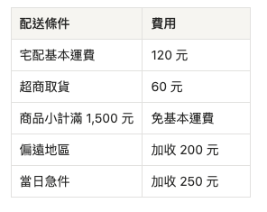
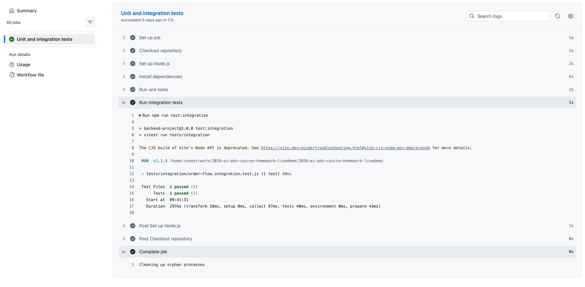

# ⭐ AI 開發進化營｜第三場作業

本次作業包含以下三項：

1. 完成配送費用模組與 Unit Test
2. 建立 Integration Test、E2E Test 與 Postman Collection
3. 建立 GitHub Actions 自動化測試流程

---

## 📌 注意事項

1. 第三場作業會延續前一場的花卉電商專案。若您尚未完成前一場作業，可下載【第一場結束後的範例儲存庫】作為起始點。
2. 若您是 8/19 之後才加入此課程的同學，請先觀看錄影再開始挑戰作業：
   - 【第三場 - 主題講座錄影】
   - 【第三場 - 作業講解錄影】
3. 本場作業主軸為「分層測試與自動化整合」，將從功能開發開始，依序完成 Unit Test、Integration Test、E2E Test、API 測試資源與 GitHub Actions。
4. 因各家 AI Agent 工具的執行方式有所差異，請依個人使用情況調整提示詞、檔案名稱與執行流程，但最終產出需符合本作業規格。
5. 請避免修改與作業無關的檔案。測試過程產生的影片、截圖、Trace、Report 與暫存資料，請依需求加入 `.gitignore`；作業指定的程式碼與產出檔案仍需提交。

---

## 1️⃣ 挑戰一：配送費用模組與 Unit Test

請在現有花卉電商專案中加入配送費用計算功能，並將運費邏輯封裝為可獨立測試的模組。

配送費用規則如下：



| 配送條件 | 費用 |
|---|---|
| 宅配基本運費 | 120 元 |
| 超商取貨 | 60 元 |
| 商品小計滿 1,500 元 | 免基本運費 |
| 偏遠地區 | 加收 200 元 |
| 當日急件 | 加收 250 元 |

### ⑴ 建立 Shipping 模組

- 在 `./src/utils/` 中建立獨立的 Shipping 模組。
- 將配送方式、偏遠地區與急件等條件集中於此模組處理。
- 將 Shipping 模組整合至現有的建立訂單流程。
- 確保 API 回傳的運費與訂單總額皆正確。
- 前端加入相關介面。

### ⑵ 更新相關文件

完成 Shipping 功能後，請同步更新：

- 專案中的 `docs` 文件
- `openapi.json`

### ⑶ 新增 Unit Test

請在 `./test/` 資料夾中加入 Shipping 模組的測試，至少涵蓋：

- 宅配基本運費
- 超商取貨費用
- 商品小計 1,499 元的情境
- 商品小計 1,500 元的免運情境
- 偏遠地區附加費
- 當日急件附加費
- 多項附加費同時成立
- 滿額免運與附加費同時成立

完成後可使用以下指令執行，並確認原有 Unit Test 與新增的 Shipping 測試皆可通過：

```bash
npm run test:unit
```

---

## 2️⃣ 挑戰二：Integration Test、E2E Test 與 Postman Collection

請為現有花卉電商專案建立完整的測試流程，驗證前端操作、後端 API、資料庫寫入、庫存更新與綠界付款流程。

### ⑴ Integration Test

請使用 Vitest 與 Supertest 建立 Integration Test。

**測試環境需符合以下條件：**

- 使用獨立的測試 SQLite 或記憶體 SQLite。
- 不得修改專案原有的 `database.sqlite`。
- 每次測試皆可建立並清除自己的測試資料。

**測試流程至少包含：**

1. 登入或建立測試會員
2. 取得商品資料
3. 將商品加入購物車
4. 建立包含配送方式與配送資訊的訂單
5. 驗證訂單建立結果

**測試內容需驗證：**

- HTTP 狀態碼與回應格式
- 訂單是否正確寫入
- 訂單品項是否正確寫入
- 配送費用是否正確
- 訂單總額是否正確
- 商品庫存是否正確扣除
- 建立訂單後購物車是否清空
- 建立訂單失敗時不留下不完整訂單
- 建立訂單失敗時不會錯誤扣除庫存

完成後可使用以下指令執行：

```bash
npm run test:integration
```

### ⑵ E2E Test

請使用 Playwright 測試既有的 `http://localhost:3001`。
測試時請直接使用已啟動的專案，不要另外啟動測試伺服器。

**登入帳號：**

- 帳號：`admin@hexschool.com`
- 密碼：`12345678`

**E2E 測試流程如下：**

1. 登入花卉電商
2. 選擇商品並加入購物車
3. 進入結帳頁面
4. 填寫配送方式與結帳資料
5. 建立訂單
6. 前往綠界測試環境
7. 選擇「網路 ATM」
8. 選擇「台灣土地銀行」
9. 點擊「前往付款」
10. 關閉提示視窗
11. 在土地銀行測試頁面點擊 Save
12. 等待綠界顯示付款成功
13. 點擊「返回商店」
14. 驗證訂單顯示「已付款」
15. 驗證訂單狀態為 `paid`

需要有付款，並返回站點後的成功截圖。

完成後可使用以下指令執行：

```bash
npm run test:e2e
```

### ⑶ Postman Collection

請執行專案現有的 OpenAPI 產生器，輸出最新的 `openapi.json`。
接著將 OpenAPI 文件轉換成可提交的 Postman Collection。

**Postman Collection 需符合以下條件：**

- 使用 `{{baseUrl}}` 作為 API 網址。
- `baseUrl` 預設值為 `http://localhost:3001`。
- 包含 `baseUrl`、`token`、`sessionId` 變數。
- 登入成功後自動儲存 JWT 至 `token`。
- 需要登入的 API 自動使用 Bearer Token。
- 產生的 Collection 必須是有效的 JSON 格式。

完成後可使用以下指令執行：

```bash
npm run postman
```

### ⑷ 統一執行指令

請在 `package.json` 中加入以下指令，並確保每一項皆可正常執行：

```bash
npm run test:unit
npm run test:integration
npm run test:e2e
npm run postman
```

> **注意：** 測試或 Postman 衍伸物，盡可能不要 commit，包含可自動生成的 Postman 檔案、E2E 測試的報告與截圖等。

---

## 3️⃣ 挑戰三：GitHub Actions 自動化測試

請將 Unit Test 與 Integration Test 加入 GitHub Actions，讓專案在程式碼更新時自動執行測試。

### ⑴ 建立 Workflow

請建立以下檔案：

```
.github/workflows/test.yml
```

### ⑵ 執行自動化測試

Workflow 中需分成兩個明確的測試步驟：

```bash
npm run test:unit
npm run test:integration
```

本次 GitHub Actions **不需要**：

- 執行 Playwright E2E Test
- 啟動額外的前端或後端服務

### ⑶ 驗證 Workflow

完成後請確認：

- Workflow YAML 格式正確。
- Unit Test 可以成功執行。
- Integration Test 可以成功執行。
- GitHub Actions 最終狀態顯示通過。

請附上 GitHub Action 測試截圖，如以下附圖：



---

## 🔷 任務繳交內容

### ① GitHub 儲存庫

請提供本次作業的 GitHub 儲存庫網址，並附上以下資訊：

- 使用的 AI Agent，例如 Claude Code、Codex CLI
- 你的挑戰等級（LV1、LV2、LV3）
- 使用的作業系統，例如 Windows PowerShell、Windows WSL2、macOS
- 新增或調整的環境變數名稱

> 請勿提交 API Key、Token、密碼或其他機密資料。

### ② GitHub Actions

請提供以下：

- GitHub Actions 執行頁面連結
- GitHub Actions 成功畫面截圖

---

## 📌 重要提醒

此作業將於 **2027/1/24（日）23:59** 截止繳交。

---

## 挑戰等級

| 等級 | 名稱 | 難度 | 完成內容 | 目標 |
|---|---|---|---|---|
| **LV 1** | 配送功能與 Unit Test | 中等 | Shipping 獨立模組、訂單流程整合、Shipping Unit Test、docs 文件更新、`openapi.json` 更新、原有 Unit Test 維持通過 | 建立功能模組與 Unit Test 之間的完整開發流程 |
| **LV 2** | 完整分層測試 | 進階 | 在 LV1 之上，全部 Unit Test、Integration Test 與 E2E Test 通過 | 從不同測試層級驗證完整的訂單與付款流程 |
| **LV 3** | 自動化測試流程 | 完整挑戰 | 在 LV2 之上，GitHub Actions Workflow，且 Unit Test 與 Integration Test 皆在 GitHub Actions 中通過 | 將測試流程整合至日常開發與 GitHub 協作流程 |
